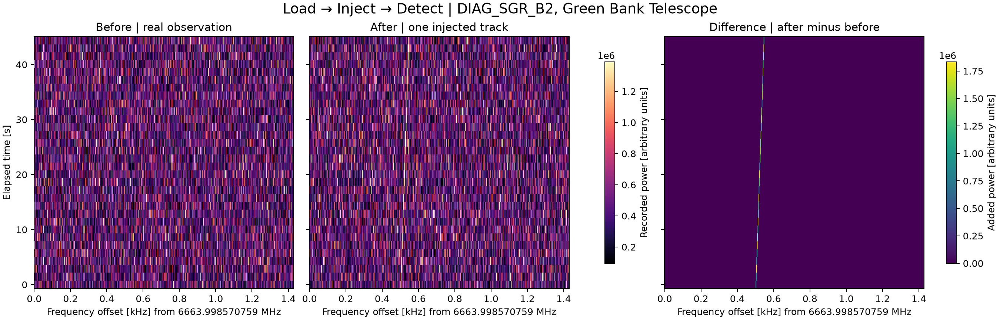

# DriftScope

Reproducible radio technosignature experiments: **load observations → inject a synthetic signal → detect it → account for pipeline losses**.

This repository contains the conventional Python baseline, preserved experiments and plans, observational cadence-access pilots, search-coverage and truncation audits, signal-survival tracking, tests, and reproducible sensitivity experiments. No LLM is used.

The experiments validate software and quantify specified engineering cases. They do not establish an extraterrestrial detection or population-level search completeness.



## Run the original experiment

Use Python 3.11. The recorded environment is macOS ARM64; other platforms have not been independently validated. The original source observation and recorded baseline outputs are included.

```bash
git clone https://github.com/Chalermsak1/DriftScope.git
cd DriftScope/technosignatures
python3.11 -m venv .venv
.venv/bin/python -m pip install -r requirements.lock
.venv/bin/python pipeline.py --output results/my_new_run
.venv/bin/python -m pytest -q tests
.venv/bin/python verify_reproduction.py
```

Use the explicit `tests` directory for this initial, offline test run. The full pilot suite additionally requires the downloaded release and independently acquired archive-range cache. See the [publication and reproduction notes](PUBLICATION.md) before running it.

The command above preserves the original `results/run_001` reference. Array/result equality checks are made in the same installed environment; timing, image bytes, and cross-platform floating-point identity are outside that guarantee.

## Research and evidence

- [Original experiment report](technosignatures/results/run_001/REPORT.md) and [full baseline documentation](technosignatures/README.md).
- [Current cadence and pipeline-loss milestone report](technosignatures/research/pilot/evidence/MILESTONE_REPORT.md).
- [Pilot methodology and reproduction commands](technosignatures/research/pilot/README.md).
- [Research plan](technosignatures/docs/RESEARCH_PLAN.md), [statistical analysis plan](technosignatures/docs/STATISTICAL_ANALYSIS_PLAN.md), [literature review](technosignatures/docs/LITERATURE_AND_NOVELTY.md), and [execution backlog](technosignatures/docs/RESEARCH_EXECUTION_BACKLOG.md).
- [Recorded pilot verification](technosignatures/research/pilot/evidence/verification.json): 53 passing tests and 47 matching scientific JSON/array comparisons in the recorded environment.
- [Publication scope, excluded assets, and validation evidence](PUBLICATION.md).

The original cadence pilot validates all stored integrations over one approximately 11.6 kHz interval of a six-scan cadence against original archive excerpts. Its eight released cutouts were previously selected candidates; they do not constitute a representative observing cohort. Later conventional development is documented separately below.

## Conventional pipeline development

The [v2 development module](technosignatures/research/conventional/README.md) adds per-drift coverage remediation, uncapped hits, path-based event grouping, timestamp-aware cadence policies, and cohort/sensitivity infrastructure. Its [milestone report](technosignatures/research/conventional/evidence/MILESTONE_REPORT.md) records 115 passing regression tests and 17 complete-repeat comparisons.

The [prospective C-band cohort pilot](technosignatures/research/cohort/README.md) adds complete original-source cadence extraction, verified resumable HTTPS ranges, paired loss accounting, and component-aware sensitivity experiments. The metadata frame contains 182 eligible cadence/product proposals in **seven linked components**; all seven are selected before inspecting spectra. Acquisition and evaluation status are recorded in its [milestone report](technosignatures/research/cohort/evidence/MILESTONE_REPORT.md).

The completed reduced pilot acquires **42 files / seven full cadences / 983,040 usable power samples** and executes **1,152 trials containing 1,344 synthetic signals**. All 42 source score maps match the scalar reference exactly; **159 tests pass**, and a fresh full execution reproduces every scientific file and trial checkpoint. A documented ancestry-assignment correction resolves 45 evaluation conflicts while preserving identical observations, injection parameters and blind-output metrics. Weighted review-safe recovery is 39.68% versus 38.43% for the legacy arm; strict-policy retention remains lower by the weighted comparison. These are exploratory development benchmarks, not evidence of population completeness or confirmatory superiority.

Published ledger consistency can be checked from the repository root with `technosignatures/.venv/bin/python scripts/cohort_validation.py`. This validates retained evidence; acquiring and independently reproducing the observations requires the [cohort reproduction steps](technosignatures/research/cohort/README.md).

Representative-cohort sensitivity remains incomplete. The approved main study requires 60 independent components; more injections into seven backgrounds cannot meet that requirement. Full observing-band coverage, statistical precision, independently verified receiver identity, flux sensitivity and locked-test evaluation remain open gates.

## Data and attribution

The small baseline observation is accompanied by [provenance](technosignatures/data/PROVENANCE.md) and the [upstream SETIGEN license notice](technosignatures/data/SETIGEN_LICENSE.txt). The pilot release is acquired separately from an immutable, checksum-pinned upstream source. Its data redistribution license was not identified, so its source payload and generated numerical arrays are excluded from Git.

Keeping the scientific project under `technosignatures/` preserves the original relative paths, source files, approved plans, and hash manifests.
