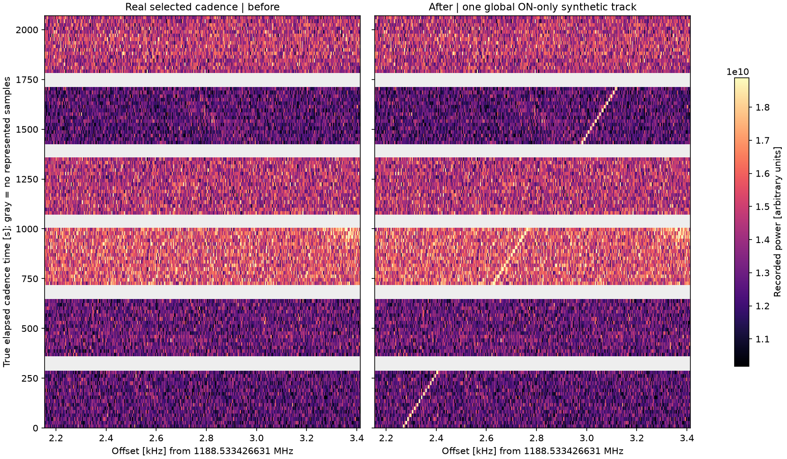

# Access pilot and pipeline-loss accounting: validated milestone

19 November 2026 · Status: **PASS within the declared narrowband engineering scope**.

This is the current combined report. The generated per-stage report in `results/milestone_001/REPORT.md` describes the release-based audit; the [source-validation addendum](CADENCE_SOURCE_VALIDATION.md) supplies the subsequent independent archive checks. Neither is a population sensitivity study.

## Completed work

| Work | Measured result |
|---|---|
| Observational release access | Eight real candidate cutouts, 48 scan/header records, six distinct scan sequences. |
| Dependence audit | Two pairs of cutouts share their scan sequences; conservative target/day grouping produces five groups. Eight cutouts are not eight independent observing sessions. |
| Independent original-source access | One complete six-scan cadence, all 16 stored integrations per scan over the selected 4096-channel interval. |
| Sample provenance | Every float32 value in all six original HDF5 excerpts matches the published release, with the frequency-slice convention confirmed. |
| Coverage audit | Original detector searches 764/1024 starting channels, or 74.609375%. |
| Discrete path audit | 390,404 searched trials versus 489,730 boxcar-valid trials; 99,326 valid discrete trials are omitted by the common guard. |
| Catalogue-cap audit | In a fully synthetic 80-line fixture, 97 post-suppression candidate peaks become 50 retained peaks. The cap discards 47 peaks and loses 30 injected physical signals. |
| Signal-survival tracking | Exclusive first-loss categories distinguish domain, guard, threshold, local-maximum, suppression, and cap effects. |
| Cadence timing check | One global synthetic chirp is recovered in all three ON scans using actual timestamp gaps; all OFF arrays are unchanged. |
| Tests | 53 passed; zero failures, errors, or skips. |
| Same-environment repeat | All 47 scientific JSON/array comparisons pass. |
| Preservation | 31 original experiment files and eight approved-plan files match their original manifests. |



Gray intervals contain no represented samples. Before and after share the intensity scale. The ON-only response is an explicit illustrative injection assumption, not a calibrated telescope beam model.

## Loss accounting

Ten fixed engineering cases were executed on the original real C-band observation:

- Four were retained.
- Two did not exceed the score threshold.
- Three had valid discrete paths but were omitted by the common start-channel guard.
- One was outside the configured drift domain.

Those outcomes are not a random sample of signals or observing conditions. Their fractions are not estimates of population completeness, and no population confidence interval is assigned to them.

The separate 80-line stress fixture uses seeded synthetic noise and synthetic signals. It produces 475 thresholded local maxima, of which 378 are suppressed, leaving 97 uncapped candidates. Signal-level matching confirms that all 80 injected tracks have compatible uncapped candidates; the original 50-candidate cap loses 30 tracks. Candidate counts and physical-signal counts remain separate throughout the evidence.

A two-track synthetic fixture retained both injected tracks; it does not demonstrate that the current frequency-suppression rule is generally safe. Every suppressed peak and its suppressor are recorded for later event-grouping work.

Six blind searches on the unmodified real cadence are also retained. A native threshold crossing is not automatically labeled terrestrial interference or extraterrestrial technology. No origin classifier was introduced.

## Source integrity and reproducibility

The released data are pinned by repository commit, SHA-256, expected size, and git-blob hash. Original archive URLs were obtained from the official index and checked through HDF5 metadata and scientific sample equality. Timestamp equality alone was insufficient: different resolution products can share timestamps, and some index timestamps differ from source headers by one second.

The six full-band source files total approximately 92.245 GB. They were not downloaded in full. The successful complete execution accessed 326.5 MiB of range blocks to reconstruct the selected full-time excerpts. Its additional-network counter reflects a cached resume and excludes earlier interrupted transfer traffic; it must not be presented as the total acquisition bandwidth.

Range reads require HTTP 206, exact offsets/file size, and a stable ETag. Cached blocks are hashed. Offline extraction is tested with HTTP disabled. Whole-file archive MD5 values have **not** been verified because entire files were not acquired.

The source interval is approximately 11.6 kHz. Source-header frequency and time calibration are inherited from the archive; telescope logs and absolute receiver calibration were not independently audited. Bitwise source matching establishes sample provenance, not a technological or astrophysical origin for any feature.

The development log preserves the initial incorrect test-count assumption, source-route failures, transfer restarts, unindexed-block quarantine, and a read-timeout attempt. Indexed cache hashes were checked, unindexed blocks were not reused, and the extractor now has a process lock, atomic cache updates, bounded retries, persistent connections, and coalesced prefetch. The original detector and scientific injection settings were not tuned to resolve those infrastructure issues.

## Reproduce and inspect

From the project root in the existing workspace:

```bash
.venv/bin/python -m research.pilot.run
.venv/bin/python -m pytest -q tests research/pilot/tests --junitxml=research/pilot/evidence/tests.xml
.venv/bin/python -m research.pilot.verify
.venv/bin/python -m research.pilot.finalize
```

See [the execution guide](../README.md) for original-source acquisition, cached offline extraction, and fresh-copy prerequisites. Large verified range caches remain in the workspace; portable packages omit them and require the documented bounded acquisition step for full source-reconstruction tests.

## Remaining gates

The representative multi-session cohort, overlap-aware search remediation, path/time event grouping, cadence rejection, integrated/smeared signal simulation, and 1,152-case morphology pilot remain unfinished. Normalization losses are not independently identified apart from threshold/noise effects in this audit. LLM development remains deferred.

The next conventional engineering milestone is to remediate coverage and grouping losses using this frozen audit as a regression reference, while acquiring a representative cohort separately. Per-task completion and partial states are recorded in [milestone_status.json](milestone_status.json).
